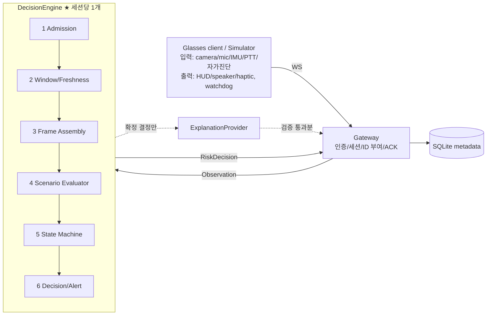

# technical specification - 판단 엔진 중심 v0.4

> **무엇을 만들지**는 `01-product-requirements.md`, **어떻게 만들지**는 이 문서, **모듈과 팀 경계**는 `03-collaboration-architecture.md`, **어떤 순서로 만들지**는 `04-implementation-plan.md`에 있다.
> 이 문서는 **구현에 필요한 결정을 모두 확정한 상태**다. 필드명, 상태, enum, 전이 조건, 계산식은 여기 적힌 그대로 구현한다.
> 이 문서에 없는 값을 지어내지 않는다. 바꿔야 한다면 이 문서를 먼저 고친다.
> 숫자 파라미터 값은 **테스트용 값**이다. 운영용 값은 Stage C에서 데이터로 정한다. 다만 파라미터의 이름, 단위, 의미는 확정이다.

---

## 1. 이름 / 구조 / 도구

| 항목 | 확정값 |
|---|---|
| 배포 이름 | `v-open-agent` |
| import 패키지 | `voa` (`apps/server/src/voa/`) |
| 환경변수 접두사 | `VOA_` |
| Python | ≥ 3.11. 실행 환경은 Docker 이미지 `python:3.11-slim-bookworm` (`docker/server.Dockerfile`) |
| 실행 환경 | `dev` target은 저장소를 `/workspace`로 mount하고 개발 도구를 포함한다. `server` target은 `apps/server/src`, `apps/server/config`만 이미지에 복사하고 Android, 테스트, 개발 도구를 포함하지 않는다. DB는 `voa-data`에 둔다. |
| 빌드 | `hatchling`, `apps/server/pyproject.toml` |
| 런타임 의존성 (Stage A) | `pydantic>=2.6,<3`, `pyyaml>=6` |
| 런타임 의존성 (Stage B 추가) | `fastapi`, `uvicorn` / 테스트용 `httpx` |
| 개발 도구 | `pytest`, `types-PyYAML`(mypy용), `ruff`(line-length 100, `select = ["E","F","I","B","UP"]`), `mypy --strict`(`apps/server/src`, `apps/server/tests`) |
| 검증 명령 | 호스트에서 `scripts/build.sh` 또는 `scripts/dev.sh`, 컨테이너에서 `scripts/check.sh` 실행. 서버 검사는 `apps/server`를 작업 디렉터리로 사용 |

```text
apps/
  server/
    pyproject.toml
    src/voa/
      contracts/   enums.py types.py observation.py decision.py messages.py
      config/      profile_loader.py
      engine/      ports.py profile.py admission.py window.py evaluator.py state_machine.py engine.py
      providers/   base.py mock.py
      simulator/   fixture.py adapter.py outputs.py watchdog.py __main__.py
      replay/      runner.py __main__.py
      explain/     repository.py validator.py template.py actions.py
      storage/     sqlite.py
      server/      settings.py auth.py runtime.py app.py ws.py dispatch.py __main__.py
    config/        profiles/ models/ devices.example.yaml
    tests/         contracts/ engine/ explain/ storage/ server/ integration/ fixtures/profiles/
  android/         app/ protocol/ session/ output/ input-mock/ input-media/ device-adapter/
contracts/
  schemas/         JSON Schema snapshots
  fixtures/        shared JSON fixtures and replay scenarios
docker/server.Dockerfile   scripts/check.sh   docs/
```

---

## 2. 시스템 개요



- **위험 상태는 엔진만 결정한다.** Gateway, Provider, VLM에는 판단 로직이 없다.
- Provider(실모델이든 mock이든)는 **프레임마다 관측 1개**를 낸다. 감지된 객체가 0개여도 관측을 낸다. 이 규칙이 있어야 엔진이 "없음"을 확인할 수 있다(D-03).
- 단일 프로세스로 만든다. 엔진은 동기 순수 로직이고, 서버가 asyncio 루프에서 호출한다.

---

## 3. 데이터 계약 (`voa.contracts`)

### 3.1 공통 규칙
- 모든 모델은 `ConfigDict(extra="forbid", frozen=True)`로 정의한다.
- 시각 필드(`*_utc`)는 tz-aware UTC `datetime`이고, JSON 직렬화는 `Z` 접미사를 붙인 ISO-8601이다.
- 정규화 좌표 `BBox = tuple[float, float, float, float]` (x1, y1, x2, y2)는 `0 ≤ x1 < x2 ≤ 1`, `0 ≤ y1 < y2 ≤ 1`을 만족해야 한다.
- `Score`는 `0.0 ≤ s ≤ 1.0`이다.
- ID는 비어 있지 않은 `str`(최대 128자, `[A-Za-z0-9_.:-]`)이다.
- `frozenset` 필드(`quality_flags`)는 **정렬된 리스트로 직렬화**한다(INV-05 바이트 동일성).
- 공통 제약 타입(`Id`, `Score`, `BBox`, `UtcDatetime`)은 `voa.contracts.types`에 둔다.

### 3.2 enum
```python
SourceKind = Literal[
    "object_detection", "track_state", "sound_event", "asr_transcript", "ocr_text", "health"
]
ClockQuality = Literal["synced", "estimated", "unknown"]
RiskState = Literal["clear", "candidate", "warning", "unknown", "resolved"]
Verdict = Literal["met", "absent", "indeterminate"]
Severity = Literal["notice", "attention"]
TextKind = Literal["approved_template", "validated_explanation"]
DeliveryState = Literal["queued", "sent", "received", "played", "expired", "unknown_delivery"]
TrackQuality = Literal["good", "degraded", "lost"]
MotionClass = Literal["static", "moving", "unknown"]
HealthStatus = Literal["ok", "degraded", "down"]
QualityFlag = Literal[
    "occluded", "camera_motion_uncompensated", "low_light", "frame_dropped", "clock_unreliable"
]
SpeakerRole = Literal["authenticated_user", "untrusted_environment", "unknown"]
```
- 원안의 `imu` kind는 MVP에서 쓰지 않으므로 뺐다. IMU는 Provider 내부에서만 쓰고, 그 결과를 `camera_motion_uncompensated` flag로 표현한다.
- 원안의 `approaching_candidate`는 MVP에서 쓰지 않는다. 단안 카메라로는 "접근"을 판정하지 않는다.

### 3.3 Observation

```python
class ModelRef(BaseModel):
    id: str
    revision: str


class Observation(BaseModel):
    schema_version: Literal["0.1.0"]
    observation_id: str  # Gateway(또는 재생기)가 부여. Provider 출력 ID를 쓰지 않는다
    session_id: str
    device_id: str
    stream_id: str  # 센서 이름: camera_0, mic_0
    seq: int  # >= 0. (session_id, stream_id, source_kind) 범위에서 단조 증가 (D-04)
    capture_ts_monotonic_ns: int  # 장치 monotonic. 같은 (stream, kind) 안의 순서 비교에만 사용
    received_at_utc: datetime  # 서버 벽시계. 로그/표시 전용, 판단에는 사용하지 않음
    server_received_mono_ns: int  # 서버 monotonic. 신선도 판정의 유일한 기준
    clock_quality: ClockQuality
    model: ModelRef | None  # mock: ModelRef(id="mock-detector", revision="0")
    quality_flags: frozenset[QualityFlag] = frozenset()
    payload: Payload  # Field(discriminator="kind")

    @property
    def source_kind(self) -> SourceKind:
        return self.payload.kind
```

**Payload** — 영상 계열은 **프레임 단위**로 만든다(D-03).

```python
class Detection(BaseModel):
    label: str
    class_id: int | None = None
    bbox: BBox
    score: Score


class DetectionPayload(BaseModel):  # 프레임당 1개. detections 는 빈 리스트일 수 있음
    kind: Literal["object_detection"]
    frame_id: str
    detections: list[Detection]


class Track(BaseModel):
    track_id: str
    label: str
    bbox: BBox
    score: Score
    quality: TrackQuality
    motion_class: MotionClass
    age_frames: int  # >= 1


class TrackPayload(BaseModel):  # 프레임당 1개. tracks 는 빈 리스트일 수 있음
    kind: Literal["track_state"]
    frame_id: str
    tracks: list[Track]


class SoundEventPayload(BaseModel):
    kind: Literal["sound_event"]
    chunk_id: str
    window_start_ns: int
    window_end_ns: int  # start < end
    events: list[tuple[str, Score]]  # (label, score), 빈 리스트 허용


class AsrPayload(BaseModel):
    kind: Literal["asr_transcript"]
    utterance_id: str
    revision: int  # >= 0
    is_final: bool
    text: str  # 최대 500자
    speaker_role: SpeakerRole
    authentication_basis: Literal["explicit_push_to_talk", "none"]


class OcrPayload(BaseModel):
    kind: Literal["ocr_text"]
    frame_id: str
    text: str  # 최대 500자, 비신뢰 데이터
    bbox: BBox
    language: str
    score: Score


class HealthPayload(BaseModel):  # 상태를 보고하는 대상 센서 = Observation.stream_id
    kind: Literal["health"]
    status: HealthStatus
    detail_code: str


class ObservationDraft(BaseModel):  # 장치/시뮬레이터/Provider 가 만드는 형태 (서버 필드 없음)
    stream_id: str
    seq: int
    capture_ts_monotonic_ns: int
    clock_quality: ClockQuality = "unknown"
    model: ModelRef | None = None
    quality_flags: frozenset[QualityFlag] = frozenset()
    payload: Payload
```
Gateway(또는 재생기)는 Draft에 `schema_version`, `observation_id`, `session_id`, `device_id`, `server_received_mono_ns`, `received_at_utc`를 붙여 `Observation`을 만든다. `clock_quality`는 기록용이며 엔진 판단에는 쓰지 않는다.

`speaker_role="authenticated_user"`는 PTT 같은 입력 채널이 인증됐다는 뜻일 뿐, 음성으로 신원을 인증했다는 뜻이 아니다.

### 3.4 RiskDecision / Alert
```python
class Alert(BaseModel):
    alert_id: str
    text: str
    text_kind: TextKind
    delivery_state: DeliveryState
    valid_until_utc: datetime | None = None  # 이 시각 이후에는 전송/재전송 금지


class RiskDecision(BaseModel):
    schema_version: Literal["0.1.0"]
    risk_event_id: str
    session_id: str
    device_id: str
    scenario_id: str
    policy_version: str  # f"{profile_id}@{profile_version}"
    state: RiskState
    previous_state: RiskState | None = None
    severity: Severity | None = None
    evidence_ids: list[str]
    reason_codes: list[ReasonCode]  # §4.8 의 Literal
    model_versions: dict[str, str] = {}  # 근거 관측들의 model.id -> revision
    decided_at_utc: datetime
    alert: Alert | None = None
    fixture_note: str | None = None  # 합성 fixture 표시용. 엔진은 항상 None을 출력
```

**모델 검증기**
1. `state == "warning"` ⇔ `alert is not None`
2. `state == "warning"` ⇒ `severity is not None` 이고 `len(evidence_ids) ≥ 1`
3. `reason_codes`는 1개 이상
4. `alert is not None` ⇒ `alert.delivery_state == "queued"` — RiskDecision은 **생성 시점의 불변 기록**이다. 이후 전달 상태(`sent`, `received` 등)는 Dispatcher와 `alerts` 테이블(§7.3, §8.1)이 따로 관리하며 RiskDecision을 수정하지 않는다.

`contracts/fixtures/risk_event.json`은 positive fixture다. JSON Schema 스냅샷은 `contracts/schemas/*.json`에 두어 Python과 Android가 공유한다.

---

## 4. 판단 엔진 (`voa.engine`) ★

### 4.0 불변식 (INV) — 각각 전용 테스트로 강제

| ID | 불변식 |
|---|---|
| INV-01 | `warning` 결정의 `evidence_ids`는 1개 이상이고, 모두 결정 시점에 window 인덱스에 존재하며 같은 세션에 속한다 |
| INV-02 | `warning` 결정의 근거 관측은 모두 결정 시점 기준 나이가 `staleness_ms` 이하다 |
| INV-03 | `unknown → warning` 전이는 없다 |
| INV-04 | `→ resolved`와 `candidate → clear`, `unknown → clear`는 오직 `absent` 판정이 `clear_frames`번 연속될 때만 일어난다 |
| INV-05 | 같은 profile에 같은 입력 이벤트 시퀀스(관측, `now_mono_ns`)를 넣으면 같은 결정 시퀀스가 나온다 (JSON 직렬화 결과가 바이트 단위로 같음) |
| INV-06 | `voa.engine`과 `voa.contracts`가 import할 수 있는 것은 표준 라이브러리 `__future__`, `dataclasses`, `typing`, `collections`, `enum`, `math`, `datetime`, `re`와 `pydantic`, 그리고 `voa.engine`/`voa.contracts` 자신뿐이다. 그 밖의 모듈(예: `time`, `random`, `os`, `pathlib`, `yaml`, `asyncio`, `socket`)은 import하지 않는다. 테스트는 이 허용 목록과 AST 상의 import를 대조한다 |
| INV-07 | Admission이 `accepted`로 판정하지 않은 관측은 상태와 카운터를 바꾸지 않는다 |
| INV-08 | `alert.text`는 해당 시나리오의 `warning_text`와 정확히 같고 `text_kind == "approved_template"`이다 |
| INV-09 | 결정은 `state`가 바뀔 때만 나온다. 바로 앞 결정과 같은 state를 연속으로 내지 않는다 |
| INV-10 | profile이 유효하지 않으면(`ProfileError`) 엔진은 모든 관측을 `config_error`로 거부하고 결정을 하나도 내지 않는다. 서버는 `readyz` 503을 반환한다 |

### 4.1 인터페이스

```python
class IdFactory(Protocol):
    def new(self, prefix: Literal["risk", "alert", "obs", "sess", "notice"]) -> str: ...
# 테스트/리플레이: SequentialIdFactory -> "risk_0001", "alert_0001" ...

class UtcClock(Protocol):
    def at(self, mono_ns: int) -> datetime: ...
# 테스트/리플레이: FixedEpochClock(epoch=2026-11-09T00:00:00Z) -> epoch + mono_ns

class DecisionEngine:
    def __init__(self, session_id: str, device_id: str, profile: PolicyProfile | ProfileError,
                 ids: IdFactory, clock: UtcClock) -> None
    def step(self, obs: Observation, now_mono_ns: int) -> StepResult      # 관측 1개 처리
    def tick(self, now_mono_ns: int) -> list[RiskDecision]                # 시간 경과만 반영
    def states(self) -> dict[str, RiskState]                              # scenario_id -> state
    def get_observation(self, observation_id: str) -> Observation | None  # 읽기 전용 근거 조회
    def is_fresh(self, observation_id: str, now_mono_ns: int) -> bool     # 상태 변경 없는 조회

@dataclass(frozen=True)
class StepResult:
    admission: AdmissionStatus
    decisions: list[RiskDecision]
```
- 엔진은 **세션당 1개**다. `now_mono_ns`는 단조 비감소여야 하며, 감소하면 `ValueError`를 던진다(호출자 버그).
- `get_observation()`과 `is_fresh()`는 window 인덱스의 읽기 전용 view다. 카운터, 상태, window 보존 기간을 바꾸지 않는다. 이미 축출된 ID는 각각 `None`, `False`를 반환한다. `now_mono_ns`가 엔진의 마지막 시각보다 과거면 `ValueError`를 던지며 조회는 엔진 시각을 전진시키지 않는다.
- `PolicyProfile`은 이미 파싱/검증된 객체로 받는다. 파일 읽기는 `voa.config.profile_loader`가 하고, 실패하면 `ProfileError`를 넘긴다(INV-06).
- **`step(obs, now)` 처리 순서**: Admission → Window 갱신 → (accepted이면) 시나리오별 Frame Assembly → 이번 호출에서 프레임이 완성된 시나리오는 **전이표 전체(§4.6)** 를 적용하고, 나머지 시나리오는 **시간 규칙(행 1/2/4)만** 적용한다.
- **`tick(now)`**: 모든 시나리오에 시간 규칙(행 1/2/4)만 적용한다. 카운터는 바꾸지 않는다.
- **한 번 호출할 때 시나리오당 전이는 최대 1회**다. 결정은 profile에 정의된 시나리오 순서대로 출력한다.
- 서버는 `VOA_TICK_INTERVAL_MS`마다 `tick()`을 호출한다. 리플레이에서는 fixture의 `tick` 라인이 이 역할을 한다.
- **시작 상태**: 모든 시나리오는 `unknown`이고 `risk_event_id = None`, 카운터는 0이다. 시작 상태에 대한 결정은 출력하지 않는다. 서버를 재시작해도 같다(상태를 복원하지 않음).
- **profile이 무효(`ProfileError`)일 때**: `step()`은 모든 관측에 `AdmissionStatus = "config_error"`를 반환하고 결정을 내지 않는다. 시나리오 목록을 알 수 없으므로 결정 출력도 없다. 이 상태는 서버 `readyz` 503과 status API로 노출한다(INV-10).
- 서버 운영 구현은 `voa.server.runtime` 안의 `SecureIdFactory`와 `AnchoredUtcClock`을 사용한다. `SecureIdFactory` ID는 `secrets.token_urlsafe(18)`을 사용해 `f"{prefix}_{token}"`으로 만들고 서버 프로세스 전체에서 하나의 factory를 공유한다. `AnchoredUtcClock`은 시작 시점의 UTC wall clock과 `time.monotonic_ns()`를 함께 고정하고, `anchor_utc + timedelta(microseconds=(mono_ns - anchor_mono_ns) // 1000)`으로 UTC를 매핑한다. `SequentialIdFactory`와 `FixedEpochClock`은 테스트와 리플레이에만 사용한다.

### 4.2 단계 1 — Admission

순서대로 검사하고, 처음 실패한 항목의 결과를 반환한다.

`AdmissionStatus = Literal["accepted", "rejected_session_mismatch", "duplicate", "out_of_order", "stale_on_arrival", "config_error"]`

| # | 검사 | 결과 `AdmissionStatus` |
|---|---|---|
| 0 | profile 무효 | `config_error` |
| 1 | `session_id`, `device_id`가 엔진과 일치 | `rejected_session_mismatch` |
| 2 | `observation_id`를 이미 받았음 (window 보존 기간 내) | `duplicate` |
| 3 | `seq ≤ last_seq[(stream_id, source_kind)]` | `out_of_order` |
| 4 | `capture_ts_monotonic_ns < last_capture[(stream_id, source_kind)]` | `out_of_order` |
| 5 | `now_mono_ns - server_received_mono_ns > staleness_ms × 1e6` (도착했을 때 이미 오래됨) | `stale_on_arrival` |
| — | 통과 | `accepted` |

- 스키마 오류는 엔진에 들어오기 전 Pydantic 파싱 단계에서 거부한다. Gateway는 이를 `rejected_schema`로 응답한다.
- `out_of_order`, `stale_on_arrival`, `duplicate`는 상태에 영향이 없다(INV-07). 카운트만 계측한다.
- 아직 `accepted` 관측이 없는 key는 3/4번 검사를 통과한 것으로 본다.

### 4.3 단계 2 — Window / Freshness
- **Window**: key `(stream_id, source_kind)`마다 `deque`를 둔다. 최근 `window_max_items`개만 유지하고, 나이가 `window_ms`를 넘은 항목은 매 호출마다 제거한다. `observation_id → Observation` 인덱스도 함께 유지하고 같이 제거한다.
- **신선도**: 관측 o는 `now_mono_ns - o.server_received_mono_ns ≤ staleness_ms × 1e6`일 때 *fresh*다.
- **센서 상태** `sensor_down[stream_id]`: `health` 관측(`stream_id` = 대상 센서)의 `status == "down"`이면 True, `"ok"`나 `"degraded"`이면 False가 된다. 기본값은 False다.

### 4.4 단계 3 — Frame Assembly (시나리오별)
- 시나리오마다 조립 버퍼(`frame_id` → kind별 관측)를 따로 둔다. `stream_id ∈ required_streams`이고 `source_kind ∈ required_kinds`인 accepted 관측만 넣는다.
- 한 `frame_id`에 `required_kinds`가 **모두** 모이면 그 프레임은 "완성"이고, 그 시나리오에 대해 **딱 한 번** 평가한 뒤 버퍼에서 지운다. 같은 frame_id로 늦게 도착한 관측은 무시한다(완성된 frame_id 집합은 `window_ms` 동안 기억).
- **완성 시점에 신선도를 다시 확인**한다. 프레임 관측 중 하나라도 fresh가 아니면 그 프레임은 평가하지 않고 버린다(INV-02 보장).
- 완성되지 않은 프레임은 평가하지 않는다. 예를 들어 tracker가 멈춰 detection만 들어오면 track 시나리오의 프레임이 완성되지 않고, 결국 행 2(`input_stale`)로 `unknown`이 된다.
- 나이가 `window_ms`를 넘은 미완성 프레임은 버퍼에서 제거한다.

### 4.5 단계 4 — Scenario Evaluator (3값)

입력은 완성된 프레임의 관측들(시나리오의 `required_kinds` 각 1개)이고, 출력은 `ConditionResult(verdict, evidence_ids, reason)`이다.

먼저 대상(candidate object)을 정의한다.
- `required_kinds = [object_detection]`이면 대상은 detection 항목들이다.
- `required_kinds = [object_detection, track_state]`이면 대상은 track 항목들이다. detection 관측은 "detector가 이 프레임을 처리했다"는 신선도 근거로만 쓴다.

대상 o가 **qualifying**이라는 것은 다음을 모두 만족한다는 뜻이다.
`o.label ∈ labels` ∧ `o.score ≥ min_score` ∧ `overlap(o.bbox, roi) ≥ roi_min_overlap` ∧ (track일 때) `o.quality != "lost"` ∧ `o.motion_class ∈ motion_classes`

여기서 `overlap(b, roi) = area(b ∩ roi) / area(b)`로 계산한다(대상 bbox 중 ROI 안에 들어간 비율).

판정 순서는 아래와 같다. 위에서부터 처음 해당하는 결과를 쓴다.

| # | 조건 | verdict | reason |
|---|---|---|---|
| 1 | 프레임 관측 중 하나라도 `blocking_flags`와 교집합이 있음 | indeterminate | `quality_blocked` |
| 2 | 대상 중 `label ∈ labels`이고 `overlap(o.bbox, roi) ≥ roi_min_overlap`이며 `quality == "lost"`인 track이 있고, qualifying 대상은 없음 | indeterminate | `track_lost` |
| 3 | qualifying 대상이 1개 이상 | met | `condition_observed` |
| 4 | 그 외 | absent | `condition_absent` |

- 판정 순서는 `blocking_flags` 검사가 먼저다. 차단 flag가 붙은 프레임에서는 met도 absent도 인정하지 않는다.
- `met`이나 `absent`일 때 `evidence_ids`는 그 프레임에 사용된 관측 ID 전부(시나리오의 required kind 수만큼)다.

### 4.6 단계 5 — State Machine (시나리오별)

**시나리오별 상태 변수**: `state`, `risk_event_id: str | None`, `met_streak: int`, `absent_streak: int`, `last_determinate_mono_ns: int | None`, `last_indeterminate_reason: ReasonCode | None`

**프레임 판정이 들어올 때 카운터 갱신** (전이표 적용 **전에** 수행)
- `met`: `met_streak += 1`, `absent_streak = 0`, `last_determinate = now`, `last_indeterminate_reason = None`
- `absent`: `absent_streak += 1`, `met_streak = 0`, `last_determinate = now`, `last_indeterminate_reason = None`
- `indeterminate`: `met_streak = 0`, `absent_streak = 0`, `last_indeterminate_reason = 판정 reason` (`last_determinate`는 그대로)

**unknown으로 전이할 때마다**(행 1/2) `met_streak = absent_streak = 0`으로 되돌린다. 그래서 unknown을 빠져나가려면 unknown 진입 **이후의** 신선한 판정이 필요하다.

**전이표** — 평가 시점마다 **위에서부터 처음 맞는 행 하나만** 적용한다. 표에 없는 전이는 일어나지 않는다.

| # | 현재 | 조건 | 다음 | reason_codes | risk_event_id |
|---|---|---|---|---|---|
| 1 | unknown 제외 | `required_streams` 중 하나라도 `sensor_down` | unknown | `[sensor_down]` | 유지 (현재가 resolved면 종료) |
| 2 | unknown 제외 | `now - last_determinate > unknown_after_ms × 1e6` | unknown | `[input_stale]` + (`last_indeterminate_reason`이 있으면 추가) | 유지 (현재가 resolved면 종료) |
| 3 | resolved | 프레임 평가이고 `met_streak ≥ 1` | candidate | `[condition_observed]` | **새로 발급** |
| 4 | resolved | (행 3에 해당하지 않음) | clear | `[episode_closed]` | **종료** |
| 5 | clear | `met_streak ≥ 1` | candidate | `[condition_observed]` | **새로 발급** |
| 6 | candidate | `met_streak ≥ confirm_frames` | warning | `[temporal_confirmation_passed]` | 유지 |
| 7 | candidate | `absent_streak ≥ clear_frames` | clear | `[condition_absent_confirmed]` | **종료** |
| 8 | warning | `absent_streak ≥ clear_frames` | resolved | `[condition_absent_confirmed]` | 유지 |
| 9 | unknown | `met_streak ≥ 1` 이고 `required_streams` 중 down인 것이 없음 | candidate | `[fresh_evidence_returned]` | 있으면 유지, 없으면 **새로 발급** |
| 10 | unknown | `absent_streak ≥ clear_frames` 이고 `required_streams` 중 down인 것이 없음 | clear | `[condition_absent_confirmed]` | **종료** |

- **시간 규칙 = 행 1/2/4.** `tick()`과, 이번 호출에서 프레임이 완성되지 않은 시나리오에는 이 세 행만 검사한다. 나머지 행은 프레임 평가에서만 적용한다.
- **resolved는 다음 평가 시점에 반드시 빠져나간다.** 새 met이면 행 3, 아니면 행 4로 간다. 같은 호출 안에서는 warning→resolved→clear처럼 두 번 전이하지 않는다.
- 행 2의 시간 비교는 unknown이 아닌 상태에서만 한다. unknown을 떠나려면 신선한 판정이 필요하므로, 이때 `last_determinate`는 항상 값이 있다.
- **warning에는 별도의 TTL 전이가 없다.** 입력이 끊기면 행 2로 unknown이 된다. `warning_ttl_ms`는 alert의 `valid_until_utc` 계산에만 쓴다.
- **profile은 엔진을 만들 때 고정된다.** 런타임에 교체하는 기능은 MVP 범위가 아니다. profile을 바꾸려면 세션을 새로 시작한다.
- **warning에서 met이 계속 들어오면** 상태를 유지하고 결정을 내지 않는다(INV-09).
- "종료"는 전이 후 `risk_event_id = None`이라는 뜻이다. 결정에는 종료 직전 값을 기록한다(§4.7).

### 4.7 단계 6 — Decision / Alert
- 전이가 일어날 때마다 `RiskDecision`을 하나 만든다.
  - `risk_event_id`: 전이 후 값. 종료되는 전이라면 종료 직전 값을 쓴다. 어느 쪽도 없으면(예: 시작 unknown → clear) 문자열 `"none"`이다.
  - `evidence_ids`: 이번 평가에서 쓴 프레임의 관측 ID. tick에서 일어난 전이라면 빈 리스트다.
  - `model_versions`: 근거 관측들의 `model`을 모은 것이다.
  - `decided_at_utc = clock.at(now_mono_ns)`
- `warning`으로 전이할 때마다(행 6) `Alert`를 새로 만든다.
  `alert_id = ids.new("alert")`, `text = scenario.warning_text`, `text_kind = "approved_template"`, `delivery_state = "queued"`, `valid_until_utc = decided_at + warning_ttl_ms`
- **중복 방지 기준은 `alert_id`다.** 같은 episode라도 unknown을 거쳐 다시 warning이 되면 새 alert를 만든다. 센서가 복구된 뒤 위험을 다시 알리는 것은 의도된 동작이다.

### 4.8 reason_code (확정 목록)
```python
ReasonCode = Literal[
    "condition_observed",
    "temporal_confirmation_passed",
    "condition_absent_confirmed",
    "episode_closed",
    "input_stale",
    "quality_blocked",
    "track_lost",
    "sensor_down",
    "fresh_evidence_returned",
]
```
`quality_blocked`와 `track_lost`는 프레임 판정 reason이다. 이 판정이 계속되어 행 2로 unknown이 되면 결정의 `reason_codes`는 `["input_stale", "quality_blocked"]`처럼 된다. `condition_absent`는 프레임 판정 reason일 뿐 결정에는 나오지 않으므로 `ReasonCode`에 넣지 않는다(evaluator 내부 Literal).

### 4.9 Policy Profile

```yaml
profile_id: indoor_research_v0
profile_version: 1
degraded_notice_text: "카메라 상태를 확인할 수 없어 감지가 제한됩니다."
params:                       # 단위는 이름의 접미사를 따른다. 값은 테스트용
  min_score: 0.5              # 0..1
  roi_min_overlap: 0.3        # 0..1
  confirm_frames: 3           # >= 1
  clear_frames: 3             # >= 1
  staleness_ms: 1000          # > 0
  unknown_after_ms: 1500      # >= staleness_ms
  warning_ttl_ms: 4000        # > 0
  window_ms: 5000             # >= unknown_after_ms
  window_max_items: 256       # >= 1
scenarios:
  - id: moving_object_in_attention_zone
    required_kinds: [object_detection, track_state]
    required_streams: [camera_0]
    labels: [person]
    motion_classes: [moving]
    roi: [0.25, 0.30, 0.75, 1.00]
    blocking_flags: [occluded, camera_motion_uncompensated, frame_dropped]
    warning_text: "전방 이동 물체에 주의하세요."
    severity: attention
  - id: visible_obstacle_in_corridor
    required_kinds: [object_detection]
    required_streams: [camera_0]
    labels: [obstacle]
    motion_classes: []        # detection 시나리오는 반드시 빈 리스트, track 시나리오는 1개 이상
    roi: [0.20, 0.40, 0.80, 1.00]
    blocking_flags: [occluded, frame_dropped]
    warning_text: "전방 통로에 장애물이 보입니다."
    severity: attention
```

**검증** — `voa.engine.profile.PolicyProfile`(Pydantic)이 수행하고, 실패하면 로더가 `ProfileError(code, detail)`로 감싼다.
- 필수 키 누락, 알 수 없는 키, 시나리오 ID 중복
- `required_kinds`가 `[object_detection]`이나 `[object_detection, track_state]` 둘 중 하나가 아님
- `motion_classes` 규칙 위반, 위 범위 조건 위반
- `warning_text`나 `degraded_notice_text`가 비어 있거나, `roi`가 BBox 규칙 위반
- 시나리오가 1개도 없음

`ProfileErrorCode = Literal["file_not_found", "yaml_invalid", "profile_invalid"]`이다. `detail`은 파일 경로와 검증 위치만 담고 YAML 원문, secret, token을 담지 않는다. YAML root가 mapping이 아니거나 YAML 파싱이 실패하면 `yaml_invalid`, Pydantic 검증 실패는 `profile_invalid`이다.

- MVP의 시나리오 kind 조합은 이 두 가지뿐이다. 오디오 시나리오는 Stage D에서 이 문서를 확장할 때 추가한다.
- `camera_motion_uncompensated`는 tracker(또는 IMU를 쓰는 provider)가 보정에 실패했을 때 붙이는 flag다. 장치에 IMU가 없으면 이동 물체 시나리오는 항상 `unknown`이 된다. 이는 의도된 동작이다(T-R15).

---

## 5. Fixture / 시뮬레이터 / 리플레이

**시나리오 fixture** `contracts/fixtures/scenarios/<name>.jsonl` — 한 줄에 이벤트 하나:
```json
{"at_ms": 0,    "obs": {"stream_id": "camera_0", "seq": 0, "capture_ts_monotonic_ns": 0, "quality_flags": [], "payload": {"kind": "object_detection", "frame_id": "f0", "detections": [{"label": "obstacle", "bbox": [0.3,0.5,0.6,0.9], "score": 0.9}]}}}
{"at_ms": 2000, "tick": true}
```
- 재생기는 다음 필드를 채운다.
  - `observation_id = f"obs_{n:04d}"` (n은 0부터 시작하는 관측 순번)
  - `session_id = "sess_fixture"`, `device_id = "dev_fixture"`, `schema_version`
  - `server_received_mono_ns = at_ms × 1e6`, `received_at_utc = clock.at(server_received_mono_ns)`
  - `clock_quality`, `model`, `quality_flags`는 fixture에 있으면 그 값을 쓰고, 없으면 Draft 기본값을 쓴다
- `now_mono_ns = at_ms × 1e6`이다. `at_ms`는 비감소여야 한다.

**기대 결과** `<name>.expected.jsonl` — 결정 하나에 한 줄. 비교 필드: `scenario_id, previous_state, state, reason_codes, evidence_ids, risk_event_id, alert_id(있으면)`

- **리플레이 CLI**: `python -m voa.replay <fixture.jsonl> [--profile path] [--expected path]`
  - 결정을 JSONL로 출력한다.
  - `--expected`가 있으면 첫 번째 불일치 위치(줄 번호와 필드)를 출력하고 exit 1로 끝난다.
  - 마지막에 `step` 처리 시간의 p50/p95(µs)를 stderr로 출력한다. 측정용이며 결정 결과에는 포함하지 않는다.
- `voa.providers.base.ObservationProvider` Protocol: `def process(self, item: object) -> list[ObservationDraft]` (Draft = 서버 필드가 없는 관측)
- `MockVisionProvider`: fixture 스크립트(프레임마다 객체 목록)로 detection과 track Draft를 만든다.

---

## 6. 설명 / 근거 검증 / 행동 (`voa.explain`)

- `ObservationRepository(engine)`: `get(observation_id) -> Observation | None`, `is_fresh(id, now)`, `session_of(id)`. 구현은 `DecisionEngine.get_observation()`과 `DecisionEngine.is_fresh()` 공개 조회만 사용하고 engine/window의 private 필드를 읽지 않는다. `session_of(id)`는 `get()`으로 조회한 `Observation.session_id`를 반환하며 없으면 `None`이다.
- `ExplanationValidator.validate(text, evidence_ids, session_id, now) -> ValidationResult(ok, violations[])`가 잡아내는 위반:

| 코드 | 규칙 |
|---|---|
| `unknown_evidence` | repository에 없는 ID |
| `foreign_session` | 다른 세션의 ID |
| `stale_evidence` | 나이가 `staleness_ms`를 넘은 근거 |
| `numeric_claim` | 정규식 `\d+(?:[.,]\d+)?\s*(?:m|cm|mm|km|km/h|㎞|미터|센티|킬로|%|퍼센트|초|분)` (대소문자 무시) 일치 |
| `identity_claim` | 부분 문자열 일치: `IDENTITY_TERMS = ("신원", "이름은", "사번", "직원번호", "얼굴 인식", "누구인지")` |
| `action_claim` | 부분 문자열 일치: `ACTION_TERMS = ("신고했", "신고 완료", "정지시켰", "멈췄", "차단했", "전송했", "호출했")` |

금칙어는 `voa.explain.validator` 모듈 상수로 둔다. 목록을 바꾸면 테스트도 함께 고친다.

- 위반이 하나라도 있으면 `TemplateExplanationProvider`가 시나리오의 `warning_text`를 반환한다(`text_kind="approved_template"`).
- `ActionExecutor.execute(action_kind, ...)`:
  - 허용 목록: `play_alert`, `show_text`, `repeat_last_verified_alert`, `acknowledge_alert`, `export_metadata_if_authorized`
  - 허용 목록에 없는 이름이 오면 `ForbiddenActionError`를 던진다.
  - `idempotency_key = sha256("|".join([device_id, scenario_id, risk_event_id, alert_id, action_kind]))`
- 비신뢰 텍스트(OCR, `speaker_role != authenticated_user`인 ASR, VLM 출력)는 행동 트리거로 들어오지 못한다. 행동은 `is_final=True` ∧ `authenticated_user` ∧ `explicit_push_to_talk`인 ASR로만 트리거하고, 허용 목록 중 읽기 전용 2개(`repeat_last_verified_alert`, `acknowledge_alert`)에만 연결한다(Stage D).

---

## 7. 서버 / 전송 (`voa.server`)

### 7.1 장치 등록과 인증
- 장치는 `apps/server/config/devices.yaml`(git에서 제외. 형식은 같은 폴더의 `devices.example.yaml`)에 다음 형태로 등록한다. 알 수 없는 키는 거부한다.
```yaml
devices:
  - device_id: dev_example
    secret_scrypt:
      salt_hex: "32 lowercase hex chars"
      digest_hex: "64 lowercase hex chars"
    allowed_inputs: [camera_0]
    allowed_outputs: [hud, speaker]
```
- `salt_hex`는 16바이트, `digest_hex`는 32바이트다. 검증값은 `hashlib.scrypt(secret.encode("utf-8"), salt=bytes.fromhex(salt_hex), n=2**14, r=8, p=1, dklen=32)`로 계산하고 `hmac.compare_digest`로 비교한다. 파라미터는 파일에서 바꾸지 않는다.
- `POST /v1/sessions {device_id, secret, capabilities: {inputs: [...], outputs: [...]}}` → `{session_id, token, token_expires_at_utc, resume_token, resume_token_expires_at_utc, heartbeat_ms, watchdog_ms}`
  - token과 resume token은 각각 `secrets.token_urlsafe(32)`로 만든다. 서버는 각 token의 SHA-256 digest만 메모리에 보관하고 검증 시 `hmac.compare_digest`를 사용한다. 평문, secret, digest를 DB와 로그에 남기지 않는다.
  - access token TTL은 `VOA_TOKEN_TTL_S`, resume token TTL은 `VOA_RESUME_TOKEN_TTL_S`다. access token은 WebSocket handshake 시점에 검증하며 이미 인증된 WebSocket은 token 만료로 즉시 종료하지 않는다.
  - `POST /v1/sessions/{session_id}/resume {resume_token}`은 세션이 서버 메모리에 있고 resume token이 유효할 때 새 access token과 resume token, 두 만료 시각을 반환한다. 성공 시 이전 token 둘을 즉시 폐기하는 일회성 회전이다.
  - 서버 프로세스가 재시작하면 token과 세션 엔진을 복원하지 않는다. resume 요청은 401이고 클라이언트는 장치 credential로 새 세션을 만든다.
  - 인증에 실패하면 401이고, 응답 본문에 원인을 구분하지 않는다.
  - 인증은 통과했지만 `capabilities`가 등록된 `allowed_*`를 벗어나면 400 `capability_not_allowed`다.
  - `outputs`가 비어 있으면 400 `no_output_capability`다. 경고를 출력할 수 없는 장치에는 세션을 열지 않는다.
  - `required_streams`가 `inputs`에 없는 시나리오는 그 세션 동안 계속 `unknown`이다. 이를 위해 서버는 세션을 시작할 때, 선언되지 않은 각 stream에 대해 `health(status="down", detail_code="not_declared")` 관측을 엔진에 먼저 넣는다. 엔진 API는 추가하지 않는다.
- `VOA_ALLOW_INSECURE_DEV=true`는 bind 주소가 `127.0.0.1`일 때만 허용한다. 이때 장치 `dev_fixture`는 secret 없이 세션을 만들 수 있다.
- `POST /v1/sessions`와 resume endpoint를 제외한 세션 범위 REST API는 `Authorization: Bearer <access token>`을 요구한다. token은 URL, query, 로그에 넣지 않는다. 해당 token의 session과 path의 session이 다르면 404 `not_found`로 응답한다.
- REST 오류 본문은 `{"code": "<stable_code>"}`다. 인증 실패는 원인과 관계없이 401 `{"code":"unauthorized"}`, capability 범위 위반은 400 `capability_not_allowed`, 빈 outputs는 400 `no_output_capability`다. 요청 원문과 secret은 응답에 넣지 않는다.

### 7.2 WS `/v1/streams/{session_id}` 메시지 (`voa.contracts.messages`)

모든 메시지는 `{"type": ..., ...}` JSON 텍스트 프레임이다.
모든 message 모델은 `extra="forbid"`, `frozen=True`이고 `type`을 discriminator로 사용한다. 예를 들어 observation은 `{"type":"observation","observation":{...ObservationDraft...}}`, decision은 `{"type":"decision","decision":{...RiskDecision...}}`처럼 payload를 명시된 키 아래에 둔다.

| 방향 | type | 필드 |
|---|---|---|
| C→S | `auth` | `token` (반드시 첫 메시지. 5초 안에 오지 않거나 실패하면 close 4401) |
| C→S | `resume` | `last_alert_seq` (auth 다음에만 허용, token 회전은 §7.1 REST endpoint 사용) |
| C→S | `observation` | ObservationDraft (서버가 `observation_id`, `server_received_*`, `received_at_utc`를 채운다) |
| C→S | `ack` | `alert_id`, `status: received\|played` |
| S→C | `auth_ok` | `session_id`, `server_time_utc` |
| S→C | `admission` | `seq`, `stream_id`, `status` (accepted 외의 결과만 보낸다) |
| S→C | `decision` | `decision`: RiskDecision 전체 (상태 표시용) |
| S→C | `alert` | `alert_seq`(세션 내 1부터 증가), Alert, `risk_event_id`, `scenario_id` |
| S→C | `notice` | `notice_id`, `kind: degraded`, `scenario_id`, `text` (§7.4 판단 불가 고지) |
| S→C | `heartbeat` | `server_time_utc`, `states: {scenario_id: RiskState}` (`VOA_HEARTBEAT_MS`마다) |
| S→C | `error` | `code`, `message` (원문 입력을 되돌려 보내지 않음) |

- `resume.last_alert_seq`는 0 이상이다. 아직 alert를 받지 않은 클라이언트는 0을 보낸다.
- 알 수 없는 type은 `error(code="unsupported_message_type")`, 알려진 type의 schema 오류는 `error(code="rejected_schema")`를 보내고 무시한다.
- auth 전 다른 메시지, 두 번째 auth, auth 전 resume는 protocol 위반이며 `error(code="protocol_error")` 후 close 4401이다.
- JSON 텍스트가 아닌 WebSocket frame은 MVP에서 `unsupported_message_type`으로 무시한다.

**예약 메시지 (MVP 미구현, Stage C/D에서 이 표를 확정)**: C→S `frame`(카메라 이미지), `audio_chunk`(PCM), `imu`(센서 배치), `ptt_start`/`ptt_end`(버튼). MVP 서버는 이 메시지가 오면 `error: unsupported_message_type`을 반환하고 무시한다.

### 7.3 전달 / ACK / 재접속
- **alert 전달 상태**: 생성 시 `queued` → WS로 보내면 `sent` → ACK를 받으면 `received` 또는 `played`(played는 received를 포함한다).
- `valid_until_utc`가 지날 때 상태가 `queued`면 `expired`, `sent`면 `unknown_delivery`로 바꿘다. `received`는 수신 확인 증거가 있으므로 기한 경과로 바꾸지 않고 `played` ACK를 기다린다. `played`는 정상 종료 상태다.
- **재접속(`resume`)**: `last_alert_seq`보다 큰 alert 중 다음 세 조건을 모두 만족하는 것만 같은 `alert_id`로 다시 보낸다.
  ① 현재 해당 시나리오 상태가 `warning` ② 그 alert가 현재 episode의 마지막 alert ③ `valid_until_utc`가 아직 지나지 않음
  나머지는 보내지 않는다.
- **중복 ACK**: 같은 `alert_id`와 같은 status의 ACK가 다시 오면 무시한다(멱등). 정상 상태 순서는 `queued < sent < received < played`이고 역행하지 않는다. `unknown_delivery`나 `expired`에서 늦은 `received` 또는 `played` ACK가 오면 해당 ACK 상태로 변경하고 허용 로그 키로 `event="late_ack"`, `alert_id`, `status`를 기록한다. `received`에서 늦은 `played`는 `played`로 올린다. `played`에서 다른 ACK는 무시한다.
- 장치에 실제로 재생할지는 장치가 `alert_id`로 판단한다. 같은 `alert_id`는 한 번만 재생하는 것이 장치 측 계약이고, 시뮬레이터가 이를 구현해 테스트한다.

### 7.4 글래스 클라이언트 입/출력 계약

글래스(실기기 앱 또는 시뮬레이터)는 **입력 수집 → 전송**과 **경고 렌더링 → ACK**, 그리고 **연결 감시**를 담당한다. 위험 판단은 하지 않는다.

**capability enum**
```python
InputCap = Literal["camera_0", "mic_0", "imu_0", "ptt_0"]
OutputCap = Literal["hud", "speaker", "haptic"]
```

**입력 채널** — 단계별로 무엇을 보내는가

| 입력 | 장치가 보내는 것 | 서버 쪽 처리 | 단계 |
|---|---|---|---|
| `camera_0` | MVP: 프레임마다 `observation`(Draft: detection/track. 시뮬레이터의 mock이 생성) | 그대로 엔진에 투입 | MVP-1 |
| `camera_0` | 실기기: `frame`(JPEG, 긴 변 ≤ 640px, `frame_id`/`capture_ts` 포함) | 서버 Provider(detector/tracker)가 Draft 생성. 이미지는 메모리 TTL 동안만 보관 | Stage C |
| `imu_0` | `imu` 배치 | tracker가 카메라 움직임 보정에 사용하고, 실패하면 `camera_motion_uncompensated` flag | Stage C |
| `mic_0` | `audio_chunk` (PCM16, 16kHz, mono) | SED/ASR Provider | Stage D |
| `ptt_0` | `ptt_start` / `ptt_end` | 이 구간의 `mic_0` 오디오만 사용자 명령 ASR로 처리 | Stage D |
| (자가 진단) | `observation`(Draft: `health`, `stream_id` = 대상 센서) — 카메라/마이크가 꺼지거나 오류일 때 `down`, 복구되면 `ok` | 엔진의 `sensor_down` | MVP-1 |

**출력 렌더링** — 장치는 `alert`와 `notice`를 선언한 모든 출력으로 내보낸다.

| 출력 | alert | notice (degraded) |
|---|---|---|
| `hud` | `text` 표시. 다음 alert가 오거나 `valid_until_utc`가 될 때까지 유지 | 상태 표시줄에 "감지 제한" 표시. 다음 heartbeat에서 해당 시나리오가 unknown이 아니면 해제 |
| `speaker` | 장치 내장 TTS로 `text`를 읽음. TTS가 없으면 고정 경고음 | `text`를 1회 읽음 |
| `haptic` | 진동 패턴 A (장치 정의) | 진동 패턴 B |

- **TTS는 장치에서 한다.** 서버는 텍스트만 보내고 오디오는 생성하지 않는다(서버 TTS는 MVP 범위 밖).
- **ACK 정의**
  - `received`: 메시지를 파싱하고 alert_id 중복 검사를 마친 직후
  - `played`: 선언한 출력 중 **하나 이상이 렌더링을 끝낸** 시점. 예: TTS 재생 종료, HUD 표시 시작, 진동 종료
  - 이미 재생한 `alert_id`가 다시 오면 렌더링하지 않고 `played` ACK만 다시 보낸다.
- **우선순위**: 새 alert는 진행 중인 notice 음성을 끊고 재생한다. notice는 alert를 끊지 않는다.

**판단 불가 고지 (`notice`)** — 서버(`dispatch.py`)가 결정을 보고 보낸다.
- 시나리오가 `candidate`나 `warning`에서 `unknown`으로 바뀌면 `notice(kind="degraded", text=profile.degraded_notice_text)`를 보낸다. clear에서 unknown으로 바뀌는 경우는 보내지 않는다(평상시 잡음 방지).
- 같은 시나리오의 notice는 다시 unknown을 벗어나기 전까지 1회만 보낸다.

**연결 감시 (장치 측 watchdog)**
- 서버는 `heartbeat_ms`(기본 1000)마다 `heartbeat`를 보낸다.
- 장치가 `watchdog_ms`(기본 3000) 동안 **아무 서버 메시지도 받지 못하면**, 장치에 내장된 고정 문구 "서버 연결이 끊겨 경고를 받을 수 없습니다."를 선언된 모든 출력으로 1회 내보낸다. 그 뒤 재접속을 시도한다(1/2/4/8초, 최대 8초 간격).
- 서버가 판단할 수 없는 상황(네트워크 단절, 서버 다운)은 **장치만 알 수 있으므로** 이 고지는 장치의 책임이다. 문구는 장치 앱에 내장하고 서버에서 받지 않는다.
- 재접속에 성공하면 `resume`을 보내고, 첫 heartbeat를 받으면 "연결 복구" 상태를 표시한다(음성 없음).

### 7.5 Backpressure / Health
- 세션 입력 큐는 `asyncio.Queue(maxsize=VOA_INPUT_QUEUE_MAX)`다. 큐에는 `observation` 중 detection/track과 후속 단계의 `frame`만 넣는다. `auth`, `resume`, `ack`, health 관측은 제어 경로에서 즉시 처리하고 큐 포화로 버리지 않는다.
- 큐가 가득 차면 같은 큐의 가장 오래된 영상 항목을 버리고 `dropped_frames += 1`과 해당 `stream_id`의 `drop_pending=true`를 기록한다. 버릴 영상 항목이 없으면 새로 들어온 영상 항목을 거부하고 동일하게 계수한다. 다음에 수락된 같은 stream의 detection/track 관측에만 `frame_dropped` flag를 붙이고 `drop_pending`을 지운다. health와 다른 stream에는 이 flag를 붙이지 않는다.
- `GET /v1/healthz`: 프로세스가 살아 있으면 200을 반환한다.
- `GET /v1/readyz`: profile 유효 ∧ DB 연결 ∧ 장치 설정 로드 성공이면 200, 아니면 503이다.
- `GET /v1/sessions/{id}/status`: 시나리오별 상태, stream별 마지막 수신 후 경과 ms, `dropped_frames`, 미확인 alert 목록.

```json
{"status":"ok"}
{"status":"ready"}
{"status":"not_ready","error_code":"profile_invalid"}
```

`not_ready.error_code`는 `profile_invalid`, `db_unavailable`, `devices_invalid` 중 하나다. 두 개 이상이면 이 순서에서 첫 코드를 반환한다.

`GET /v1/sessions/{id}/status`의 200 응답은 아래 필드를 정확히 사용한다. 미등록 또는 다른 장치의 세션은 세부 원인 없이 404 `{"code":"not_found"}`다.

```json
{
  "session_id": "sess_x",
  "device_id": "dev_x",
  "scenarios": [{"scenario_id": "visible_obstacle_in_corridor", "state": "unknown"}],
  "streams": [{"stream_id": "camera_0", "last_received_age_ms": null, "dropped_frames": 0}],
  "pending_alerts": [
    {
      "alert_id": "alert_x",
      "alert_seq": 1,
      "delivery_state": "sent",
      "valid_until_utc": "2026-11-09T03:15:04Z"
    }
  ]
}
```

`last_received_age_ms`는 수신 이력이 없으면 `null`, 있으면 서버 monotonic 시각 기준 0 이상 정수다. `pending_alerts`는 `queued`, `sent`, `received`, `unknown_delivery` 상태만 `alert_seq` 오름차순으로 담고 `played`, `expired`는 제외한다. alert text와 token은 포함하지 않는다.

---

## 8. 저장 / 보안 / 설정

### 8.1 SQLite (`voa.storage`) 테이블 — 이 목록 외의 테이블/컬럼 금지, BLOB 금지
- `sessions(session_id PK, device_id, started_at_utc, ended_at_utc NULL)`
- `observations_meta(observation_id PK, session_id, stream_id, source_kind, seq, admission_status, received_at_utc, quality_flags_json, model_id NULL, model_revision NULL)` — payload는 저장하지 않는다
- `decisions(id INTEGER PK, session_id, risk_event_id, scenario_id, previous_state NULL, state, reason_codes_json, evidence_ids_json, policy_version, decided_at_utc)`
- `alerts(alert_id PK, session_id, risk_event_id, scenario_id, alert_seq, delivery_state, valid_until_utc, updated_at_utc)`
- **보존 기간 정리**: 서버를 시작할 때와 그 뒤 1시간마다, 테이블별 기준 컬럼(`sessions.started_at_utc`, `observations_meta.received_at_utc`, `decisions.decided_at_utc`, `alerts.updated_at_utc`)이 `now - VOA_METADATA_RETENTION_DAYS`보다 이전인 행을 삭제한다.
- 쓰기는 `voa.storage`만 한다. 엔진은 저장소를 모르고, 서버가 엔진 결과를 받아 기록한다.

### 8.2 로그
- `logging`으로 JSON 한 줄씩 기록한다.
- 허용 키: `event, session_id, device_id, stream_id, seq, observation_id, scenario_id, state, reason_codes, alert_id, status, latency_us, error_code`
- 이 목록에 없는 키는 포맷터가 버린다. 토큰, secret, payload, text 필드는 구조적으로 로그에 남을 수 없다.

### 8.3 설정 (`voa.server.settings`, 환경변수 → 기본값)
```dotenv
VOA_PROFILE=dev-mock                 # dev-mock | pilot
VOA_BIND=127.0.0.1
VOA_PORT=8765
VOA_ALLOW_INSECURE_DEV=true          # pilot 에서는 false 강제
VOA_TLS_CERT=                        # pilot 에서 필수 (cert/key 없으면 시작 거부)
VOA_TLS_KEY=
VOA_POLICY_PROFILE=config/profiles/indoor_research_v0.yaml
VOA_DEVICES_FILE=config/devices.yaml
VOA_DB_PATH=var/voa.sqlite3
VOA_TICK_INTERVAL_MS=100
VOA_HEARTBEAT_MS=1000                # 세션 응답의 heartbeat_ms
VOA_CLIENT_WATCHDOG_MS=3000          # 세션 응답의 watchdog_ms (>= 2 × HEARTBEAT)
VOA_TOKEN_TTL_S=900
VOA_RESUME_TOKEN_TTL_S=86400
VOA_INPUT_QUEUE_MAX=64
VOA_METADATA_RETENTION_DAYS=7
VOA_RAW_MEDIA_STORAGE=false          # MVP 에서는 true 로 설정하면 시작 거부 (저장 경로 미구현)
VOA_EXTERNAL_NETWORK=false
VOA_MODEL_AUTO_DOWNLOAD=false
```

상대 경로 설정은 서버 작업 디렉터리 `apps/server`를 기준으로 해석한다. 따라서 기본 `config/profiles/...`와 `config/devices.yaml`은 저장소 기준 `apps/server/config/...`를 가리킨다.

숫자 설정은 `TICK_INTERVAL_MS > 0`, `HEARTBEAT_MS > 0`, `CLIENT_WATCHDOG_MS >= 2 × HEARTBEAT_MS`, `TOKEN_TTL_S > 0`, `RESUME_TOKEN_TTL_S >= TOKEN_TTL_S`, `INPUT_QUEUE_MAX >= 1`, `METADATA_RETENTION_DAYS >= 1`을 만족해야 한다. 위반하면 서버는 시작하지 않는다.

`python -m voa.server`는 운영 진입점이다. `VOA_BIND`, `VOA_PORT`로 uvicorn을 시작하고 `VOA_PROFILE=pilot`이면 검증된 `VOA_TLS_CERT`, `VOA_TLS_KEY`를 uvicorn SSL 인자로 넘긴다. `server.app:app`을 import하는 것만으로 서버를 시작하지 않는다.

---

## 9. 실모델 후보 / 라이선스 등록부 (Stage C 이후)

| 용도 | 후보 | 라이선스 상태 |
|---|---|---|
| 객체 탐지 | YOLOX-Nano/Tiny | 코드 Apache-2.0 / 체크포인트 `review_required` |
| 추적 | ByteTrack | MIT 후보 / `review_required` |
| 소리 이벤트 | YAMNet 또는 대체 | `review_required` |
| 한국어 STT | 소형 오픈 ASR (모델명은 Stage D 진입 시 확정) | `review_required` |
| OCR | PaddleOCR 한국어 | 코드 Apache-2.0 / 모델 `review_required` |
| 설명 VLM | 소형 오픈 VLM (모델명은 Stage E 진입 시 확정) | `review_required` |

- 기본 설치에서 제외: Ultralytics(AGPL), NC 가중치(예: Depth Anything V2 Base 이상)
- 모델 manifest: `apps/server/config/models/<id>.yaml` = `{model_id, revision, sha256, license, license_evidence_url, redistribution_allowed, reviewed_at, reviewer}`

### 9.1 Python dependency registry

`apps/server/pyproject.toml`의 런타임, 모든 optional-dependencies 그룹, build-system 직접 의존성을 아래 표에 등록한다. 패키지 이름은 대소문자와 `-`, `_`, `.` 차이를 정규화해 비교한다. 의존성을 추가하면 같은 작업에서 이 표도 갱신한다.

`Default install=yes`는 현재 기본 런타임, 개발 또는 빌드 설치에 포함됨을 뜻한다. Stage B 예정 의존성은 아직 `no`다. 모든 직접 의존성과 `yes` 항목은 허용적 SPDX 라이선스(MIT, Apache-2.0, BSD-2-Clause, BSD-3-Clause, ISC, 0BSD)여야 하며 비공개 API 의무가 없어야 한다. AGPL, NC, 미검토 라이선스는 이 검사에 통과하지 못한다. 이 검사는 네트워크나 설치 패키지 메타데이터를 읽지 않고 명시된 등록부를 검증한다.

| Package | License (SPDX) | Default install | Non-public API required |
|---|---|---|---|
| pydantic | MIT | yes | no |
| PyYAML | MIT | yes | no |
| pytest | MIT | yes | no |
| ruff | MIT | yes | no |
| mypy | MIT | yes | no |
| types-PyYAML | Apache-2.0 | yes | no |
| hatchling | MIT | yes | no |
| FastAPI | MIT | no | no |
| uvicorn | BSD-3-Clause | no | no |
| httpx | BSD-3-Clause | no | no |
